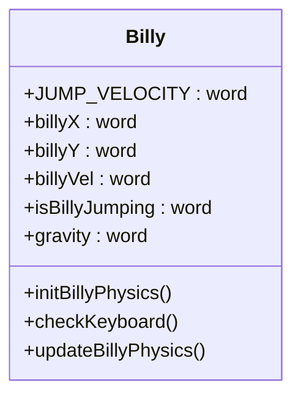

# Jump and Gravity Implementation

This section explains how jumping and gravity are handled in the game.



## Billy State
In order for us to handle jumping, we need to be able to keep track of billy's current state. For instance, we need to know if he is already jumping, what is his position, and his velocity. So we created a few data labels to store this information.

```asm
# Initialize Billy's physics
initBillyPhysics:
    billyX: .word 18
    billyY: .word 26
    isBillyJumping: .word 0
    gravity: .word 1
```

Additionally, we declared a constant for the jump velocity. This allows us to easily change how high Billy jumps, and tweak the game feel.
```asm
.eqv JUMP_VELOCITY: -5
```
We set it as a negative value so Billy moves up initially when jumping, 

## Calculating new position with velocity and gravity
Since we simply want to make billy move up on the bitmap display, this means we need to decrease billy's y coordinate. To do this, we subtracted a value from it. But this will mean that our representation of billy on the screen will move up from the ground and then almost instantaneously appear at the top. To update his position a bit more smoothly, we decided to use velocity and gravity.

Recall that our screen coordinates are such that y increases downward and x increases to the right. Since we want to move up, we needed a way to decrease y at a steady rate. So by using a negative velocity and a positive gravity, we can achieve this like so:

Lets say that billy is at y=26, which is on the ground. When the space key is pressed, he will have his velocity set from 0 to -5 and gravity from 0 to 1. And from there, each time the calculation is done, we save the new value of velocity and y. Using the following formula:

$$
v_{new} = v_{old} + g
$$
Then we update y using the new velocity:
$$
y_{new} = y_{old} + v_{new}
$$

### Frame by Frame
Billy starts jumping.
**Frame 1:**

$$
v_{new} = -5 + 1 = -4 \\
y_{new} = 26 + (-4) = 22
$$

**Frame 2:**
$$
v_{new} = -4 + 1 = -3 \\
y_{new} = 22 + (-3) = 19
$$

**Frame 3:**
$$
v_{new} = -3 + 1 = -2 \\
y_{new} = 19 + (-2) = 17
$$

**Frame 4:**
$$
v_{new} = -2 + 1 = -1 \\
y_{new} = 17 + (-1) = 16
$$

Billy reaches the top
**Frame 5:**
$$
v_{new} = -1 + 1 = 0 \\
y_{new} = 16 + 0 = 16
$$

Billy starts falling.
**Frame 6:**
$$
v_{new} = 0 + 1 = 1 \\
y_{new} = 16 + 1 = 17
$$
**Frame 7:**
$$
v_{new} = 1 + 1 = 2 \\
y_{new} = 17 + 2 = 19
$$
**Frame 8:**
$$
v_{new} = 2 + 1 = 3 \\
y_{new} = 19 + 3 = 22
$$
**Frame 9:**
$$
v_{new} = 3 + 1 = 4 \\
y_{new} = 22 + 4 = 26
$$
Billy lands.


Billy moves up with negative velocity.


This way billy will move up and then come down gradually. We just need to keep track of the velocity and apply it each frame.

Therefore, for our jump function, we need to track of the velocity and apply gravity each frame. We can declare a constant for the jump velocity and use it to update y each frame. By defining a constant jump velocity we can easily control how high billy jumps.


